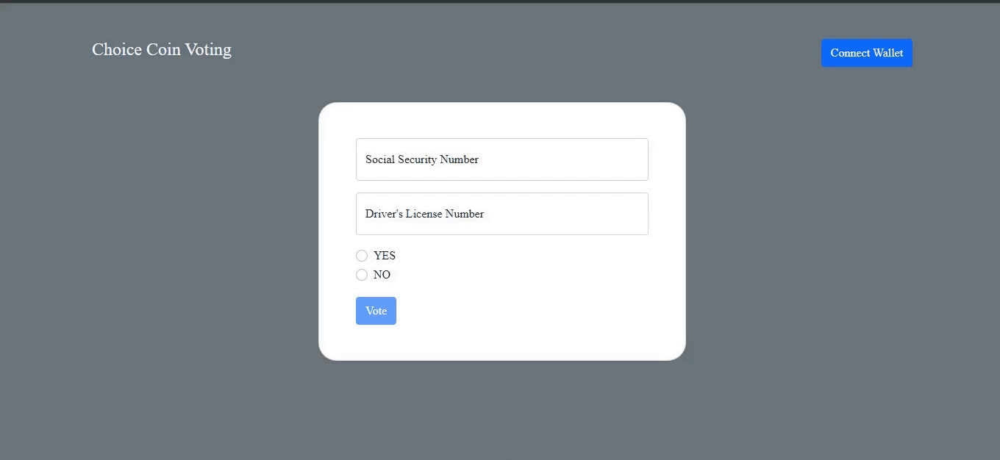

# Choice Coin App
## Wendy Enyinnaya

Decentralized decision infrastructure on Algorand — a marketing site plus the
wallet-connected voting app.



## Structure

| File | Purpose |
| --- | --- |
| `index.html` | Launch site — hero, protocol grid, how it works, testimonials, FAQ, pricing |
| `app.html` | The voting app (MyAlgo wallet connect + ballot form) |
| `assets/css/styles.css` | Design tokens, layout and the motion system |
| `assets/js/main.js` | Cursor glow, scroll reveals, carousel, pricing toggle, accordion |
| `myalgo.min.js` | MyAlgo Connect bundle used by `app.html` |

## Running it

Everything is static — no build step, no dependencies. Open `index.html`
directly, or serve the folder:

```sh
python3 -m http.server 8000
```

Then visit <http://localhost:8000>. The site is ready to publish as-is on
GitHub Pages (Settings → Pages → deploy from branch, root folder).

## Motion

Animations are transform/opacity only, driven by Intersection Observer and
`requestAnimationFrame`, with a shared `cubic-bezier(0.22, 1, 0.36, 1)` easing
curve. The site degrades gracefully:

- `prefers-reduced-motion: reduce` removes parallax, character reveals and the
  logo marquee, and hides the custom cursor.
- The custom cursor is disabled on touch and coarse-pointer devices.
- Without JavaScript, a `<noscript>` block reveals all content immediately.
- Section headings keep their full text for screen readers via `aria-label`
  while individual characters animate.
